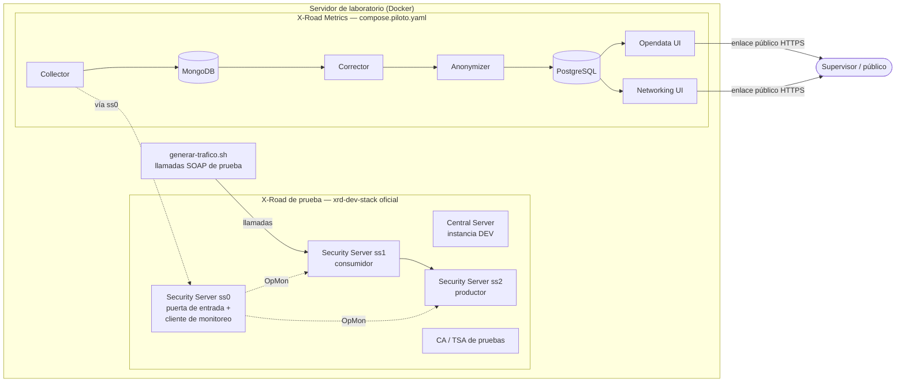

# 12 — Laboratorio: X-Road de prueba + X-Road Metrics + enlace público

**Objetivo:** montar en un solo servidor un laboratorio completo y desechable: una plataforma X-Road de prueba que genera tráfico real, los componentes de X-Road Metrics recolectándolo, y un enlace público para supervisar el flujo resultante (gráficas de Opendata y mapa de Networking). Sirve para validar de principio a fin todo lo documentado (docs 01–11) sin tocar la plataforma real, y como entorno de demostración/formación.

> Todo el laboratorio usa la instancia de desarrollo **`DEV`**, certificados de una CA de pruebas y datos sintéticos. **Nunca** se conecta a la instancia real ni se reutilizan sus credenciales.

## Arquitectura del laboratorio



Piezas:
1. **`xrd-dev-stack`**: la pila de desarrollo oficial de X-Road (hoy en el repo `nordic-institute/X-Road`, carpeta `development/docker/xrd-dev-stack`; en versiones anteriores estaba en `Docker/xrd-dev-stack`). Levanta en contenedores un Central Server, varios Security Servers (`ss0`, `ss1`, `ss2`), una CA/TSA de pruebas y miembros de ejemplo, unidos por la red Docker **`xroad-network`**. Es exactamente la pila que el setup Docker oficial de Metrics espera encontrar.
2. **X-Road Metrics con `compose.piloto.yaml`** (doc 11): sus valores por defecto ya son los de esta pila — instancia `DEV`, CS en el host `cs`, SS puerta de entrada `ss0:8080`, cliente de monitoreo `COM/1234/metrics` — y se conecta a la misma red `xroad-network`.
3. **`deploy/docker/lab/generar-trafico.sh`**: genera llamadas SOAP de prueba entre miembros (con un fallo inducido cada 10, para ver también errores en las gráficas).
4. **Enlace público**: solo se publican Opendata y Networking (datos **anonimizados**), nunca el resto.

## Paso a paso

### Paso 1 — Servidor
Un host Linux con Docker Engine + Compose v2 y git. Como referencia, el laboratorio completo (pila X-Road + Metrics) funciona con ~4 vCPU y 8–16 GB de RAM; es un entorno de pruebas, no de rendimiento.

### Paso 2 — Levantar la X-Road de prueba
```bash
git clone https://github.com/nordic-institute/X-Road.git
cd X-Road/development/docker/xrd-dev-stack   # en clones antiguos: Docker/xrd-dev-stack
# Seguir el README de esa carpeta para construir y levantar la pila
# (deja creada la red xroad-network y los servicios cs, ss0, ss1, ss2)
docker compose ps   # verifica que cs y los ss* están en marcha
```
Comprobación mínima: entra en la UI del Central Server y de un Security Server y verifica que la instancia `DEV` y los miembros de ejemplo existen.

### Paso 3 — Registrar el cliente de monitoreo
En la configuración del Central Server / del SS puerta de entrada (`ss0`), el subsistema cliente de monitoreo debe existir y estar autorizado (es el único paso manual que exige el propio README oficial de Metrics para Docker). La identidad esperada por el piloto:

| Campo | Valor |
|---|---|
| Instancia | `DEV` |
| Clase de miembro | `COM` |
| Código de miembro | `1234` |
| Código de subsistema | `metrics` |
| Método de conexión del subsistema | `HTTP` |

Además, OpMon debe estar habilitado en los Security Servers a monitorizar (por defecto en la pila de desarrollo; verifícalo según doc 05, Paso 0).

### Paso 4 — Levantar X-Road Metrics
Con el `.env` del piloto **sin cambios** (los valores por defecto son los de este laboratorio):
```bash
# desde la carpeta deploy/docker de ESTE proyecto
bash desplegar.sh piloto
```
Esto construye las imágenes de Metrics, genera los init de BD para `DEV` y levanta MongoDB, PostgreSQL, Corrector, Opendata y Networking.

### Paso 5 — Generar tráfico y recolectar
```bash
# Ajusta SS_URL y los identificadores del servicio a lo registrado en tu pila
bash deploy/docker/lab/generar-trafico.sh 50

# Recolecta el flujo generado (primera vez: update y luego collect)
cd <X-Road-Metrics>/Docker
docker compose -f compose.piloto.yaml run --rm collector_module update
docker compose -f compose.piloto.yaml run --rm collector_module collect
docker compose -f compose.piloto.yaml run --rm anonymizer_module
```
El Corrector corre en continuo; espera unos minutos a que procese los registros antes de anonimizar.

### Paso 6 — Supervisar el flujo (local)
| Qué mirar | Dónde | Qué deberías ver |
|---|---|---|
| Latido del sistema | `http://localhost:8000/api/heartbeat` | Respuesta OK de Opendata |
| Uso de servicios | Opendata — `http://localhost:8000` | Las llamadas del Paso 5 por servicio/miembro, incluidos los fallos inducidos |
| Mapa de intercambio | Networking — `http://localhost:8001` | El grafo consumidor → productor del laboratorio |
| Volumen recolectado | Logs del Collector y conteos en MongoDB | 2 registros por llamada (consumidor + productor) |

### Paso 7 — Publicar el enlace público
Solo Opendata y Networking, y solo tras el Paso 5 (datos ya anonimizados en PostgreSQL):

- **Opción demo (rápida): Cloudflare Tunnel.** `deploy/docker/lab/compose.tunel.yaml` levanta `cloudflared` unido a la red de Metrics y publica ambos servicios con HTTPS bajo tu dominio (o un enlace temporal de prueba). No abre puertos en el servidor.
- **Opción estable: dominio + proxy inverso.** Un Nginx/Caddy del propio servidor con certificado Let's Encrypt apuntando a `127.0.0.1:8000` y `127.0.0.1:8001` (los composes ya atan esos puertos a localhost). Recomendado: Opendata abierto (es su finalidad) y **Networking protegido** con autenticación básica o por IP, porque es una herramienta de análisis interno.

Reglas que no se negocian ni en el laboratorio:
- **Nunca** publicar MongoDB, PostgreSQL, Mongo Express/Adminer ni las consolas de administración de X-Road.
- El enlace público muestra datos del laboratorio (`DEV`); no mezclar con datos de la plataforma real.
- Si el laboratorio pasa a ser una demo permanente, cambia todas las contraseñas por defecto del `.env` aunque sea de pruebas.

## Qué valida este laboratorio
El flujo completo de la cadena de valor de Metrics con tráfico real: OpMon en los SS → Collector → Corrector → Anonymizer → PostgreSQL → Opendata/Networking, incluidas las pruebas P-01 a P-08 de `docs/09` ejecutables tal cual sobre el laboratorio. Cuando el piloto con la plataforma real empiece (doc 10, Fase 1), la única diferencia será la fuente: los SS reales en lugar de `ss0/ss1/ss2`.

## Limpieza
```bash
docker compose -f compose.piloto.yaml down -v     # Metrics (en su carpeta Docker/)
docker compose down -v                            # xrd-dev-stack (en su carpeta)
```
