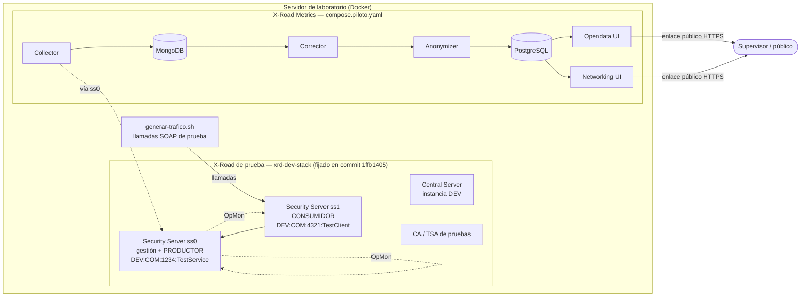

# 12 — Laboratorio: X-Road de prueba + X-Road Metrics + enlace público

**Objetivo:** montar en un solo servidor un laboratorio completo y desechable: una plataforma X-Road de prueba que genera tráfico real, los componentes de X-Road Metrics recolectándolo, y un enlace público para supervisar el flujo resultante (gráficas de Opendata y mapa de Networking). Sirve para validar de principio a fin todo lo documentado (docs 01–11) sin tocar la plataforma real, y como entorno de demostración/formación.

> **Corrección verificada 2026-11-20:** la pila `xrd-dev-stack` ya **no existe en la rama actual (`develop`)** de `nordic-institute/X-Road`: fue eliminada el 2025-09-19 (commit `30f8f3b684779d248d0bccea97eadc21f18c565b`, «chore: remove unused files and restructure development and deployment file structure»). Vivía en `Docker/xrd-dev-stack`; tampoco existe `development/docker/xrd-dev-stack`. La última versión usable es la del commit padre inmediato `1ffb1405da1a84c3afaf597dde77d891883a7e1c`. Además la topología real **no tiene `ss2`**: solo `ss0` (gestión + productor) y `ss1` (consumidor). Verificado contra el README y `compose.dev.yaml` de ese commit y el árbol completo de `develop` (HEAD `ea7d2ad4`, 2026-11-20). Si se quiere la versión más reciente de X-Road, los sucesores actuales son `development/docker/central-server/`, `development/docker/security-server/`, `development/docker/test-services/` y `development/hurl/scenarios/setup.hurl`, pero **no forman un único stack** y la red del SS actual es `xrd-ss-network`, distinta de `xroad-network`, por lo que habría que adaptar el piloto. Para el laboratorio, la vía recomendada es la pila fijada en `1ffb1405`.

## Arquitectura del laboratorio



Piezas:
1. **`xrd-dev-stack` (fijado en el commit `1ffb1405`)**: la pila de desarrollo oficial de X-Road en su última versión con este stack (hoy eliminada de `develop`; ver nota al inicio). Levanta en contenedores un Central Server, dos Security Servers (`ss0` y `ss1` — no hay `ss2`), una CA/TSA de pruebas y los sistemas de ejemplo (`example-adapter` ISSOAP, `example-restapi` ISOPENAPI, Wiremock ISREST), unidos por la red Docker **`xroad-network`**. `ss0` es el SS de gestión y además el productor del servicio de ejemplo bajo `DEV:COM:1234:TestService`; `ss1` es el consumidor, con `DEV:COM:4321:TestClient` registrado y autorizado a llamar a todo `TestService`. El arranque oficial es con el script `./local-dev-run.sh --initialize` (que inicializa el entorno con hurl), no solo con `docker compose up`. Puertos publicados por el perfil dev (`compose.dev.yaml`): CS frontend `4100`, ss0 frontend `4200` y proxy de mensajes `4210`, ss1 frontend `4300` y proxy de mensajes `4310` (dentro de la red, el proxy es el `8080` de cada contenedor).
2. **X-Road Metrics con `compose.piloto.yaml`** (doc 11): sus valores por defecto ya son los de esta pila — instancia `DEV`, CS en el host `cs`, SS puerta de entrada `ss0:8080`, cliente de monitoreo `COM/1234/metrics` — y se conecta a la misma red `xroad-network`.
3. **`deploy/docker/lab/generar-trafico.sh`**: genera llamadas SOAP de prueba entre miembros (con un fallo inducido cada 10, para ver también errores en las gráficas).
4. **Enlace público**: solo se publican Opendata y Networking (datos **anonimizados**), nunca el resto.

## Paso a paso

### Paso 1 — Servidor
Un host Linux con Docker Engine + Compose v2 y git. Como referencia, el laboratorio completo (pila X-Road + Metrics) funciona con ~4 vCPU y 8–16 GB de RAM; es un entorno de pruebas, no de rendimiento.

### Paso 2 — Levantar la X-Road de prueba
```bash
git clone https://github.com/nordic-institute/X-Road.git
cd X-Road
git checkout 1ffb1405da1a84c3afaf597dde77d891883a7e1c   # última versión con xrd-dev-stack (eliminado de develop el 2025-09-19)
cd Docker/xrd-dev-stack
# Arranque oficial según su README: inicializa el entorno (tarda unos minutos; reintentos HTTP durante la distribución de la configuración global son normales)
./local-dev-run.sh --initialize
docker compose ps   # verifica que cs, ss0 y ss1 están en marcha
```
Comprobación mínima: entra en la UI del Central Server (`http://localhost:4100`) y de un Security Server (ss0 `http://localhost:4200`, ss1 `http://localhost:4300`) y verifica que la instancia `DEV` y los miembros de ejemplo existen. Los servicios `cs`, `ss0` y `ss1` deben estar en la red `xroad-network`, que es la que el piloto de Metrics espera encontrar.

### Paso 3 — Registrar el cliente de monitoreo
En la configuración del Central Server / del SS puerta de entrada (`ss0`), el subsistema cliente de monitoreo debe existir y estar autorizado (es el único paso manual que exige el propio README oficial de Metrics para Docker). Ojo: `ss0` es a la vez el SS de gestión y el productor del ejemplo, así que el cliente de monitoreo se registra bajo su mismo miembro (`COM/1234`), como un subsistema más (`metrics`), distinto del productor `TestService`. La identidad esperada por el piloto:

| Campo | Valor |
|---|---|
| Instancia | `DEV` |
| Clase de miembro | `COM` |
| Código de miembro | `1234` |
| Código de subsistema | `metrics` |
| Método de conexión del subsistema | `HTTP` |

Además, OpMon debe estar habilitado en los Security Servers a monitorizar (por defecto en la pila de desarrollo; verifícalo según doc 05, Paso 0).

### Paso 4 — Levantar X-Road Metrics
Con el `.env` del piloto **sin cambios** (los valores por defecto son los de este laboratorio):
```bash
# desde la carpeta deploy/docker de ESTE proyecto
bash desplegar.sh piloto
```
Esto construye las imágenes de Metrics, genera los init de BD para `DEV` y levanta MongoDB, PostgreSQL, Corrector, Opendata y Networking.

### Paso 5 — Generar tráfico y recolectar
```bash
# El tráfico sale del CONSUMIDOR ss1 (proxy de mensajes: 4310 en el host, 8080 dentro de la red)
# y llama al servicio real de ejemplo: DEV:COM:1234:TestService/getRandom (v1)
SS_URL=http://localhost:4310 bash deploy/docker/lab/generar-trafico.sh 50

# Recolecta el flujo generado (primera vez: update y luego collect)
cd <X-Road-Metrics>/Docker
docker compose -f compose.piloto.yaml run --rm collector_module update
docker compose -f compose.piloto.yaml run --rm collector_module collect
docker compose -f compose.piloto.yaml run --rm anonymizer_module
```
El Corrector corre en continuo; espera unos minutos a que procese los registros antes de anonimizar.

### Paso 6 — Supervisar el flujo (local)
| Qué mirar | Dónde | Qué deberías ver |
|---|---|---|
| Latido del sistema | `http://localhost:8000/api/heartbeat` | Respuesta OK de Opendata |
| Uso de servicios | Opendata — `http://localhost:8000` | Las llamadas del Paso 5 por servicio/miembro, incluidos los fallos inducidos |
| Mapa de intercambio | Networking — `http://localhost:8001` | El grafo consumidor → productor del laboratorio |
| Volumen recolectado | Logs del Collector y conteos en MongoDB | 2 registros por llamada (consumidor + productor) |

### Paso 7 — Publicar el enlace público
Solo Opendata y Networking, y solo tras el Paso 5 (datos ya anonimizados en PostgreSQL).

> **Decisión (2026-11-21): enlace demo con Cloudflare Tunnel.** Es la vía elegida para este laboratorio; la alternativa estable (dominio propio + Nginx/Caddy con Let's Encrypt a `127.0.0.1:8000`/`127.0.0.1:8001`) queda documentada en `deploy/docker/README.md` por si la demo se vuelve permanente.

Checklist del túnel:
1. En Cloudflare Zero Trust → *Networks → Tunnels*: crear un túnel y copiar su token.
2. Rutas públicas del túnel (con un dominio gestionado en Cloudflare):
   - `opendata.<tu-dominio>` → `http://opendata_module:80`
   - `networking.<tu-dominio>` → `http://networking_module:3838`
3. En el servidor del laboratorio, con el piloto ya levantado:
   ```bash
   TUNNEL_TOKEN=<token> docker compose -f deploy/docker/lab/compose.tunel.yaml up -d
   ```
   El contenedor `cloudflared` se une a la red `xrd-metrics-network` y alcanza ambos servicios por su nombre. No se abre ningún puerto en el servidor.
4. Comprobar desde fuera: `https://opendata.<tu-dominio>` muestra las gráficas y `https://networking.<tu-dominio>` el mapa. (Sin dominio propio, alternativa exprés para una demo puntual: `cloudflared tunnel --url http://localhost:8000` genera una URL temporal `*.trycloudflare.com`, un servicio cada vez.)

Reglas que no se negocian ni en el laboratorio:
- **Nunca** publicar MongoDB, PostgreSQL, Mongo Express/Adminer ni las consolas de administración de X-Road.
- El enlace público muestra datos del laboratorio (`DEV`); no mezclar con datos de la plataforma real.
- Si el laboratorio pasa a ser una demo permanente, cambia todas las contraseñas por defecto del `.env` aunque sea de pruebas.

## Qué valida este laboratorio
El flujo completo de la cadena de valor de Metrics con tráfico real: OpMon en los SS → Collector → Corrector → Anonymizer → PostgreSQL → Opendata/Networking, incluidas las pruebas P-01 a P-08 de `docs/09` ejecutables tal cual sobre el laboratorio. Cuando el piloto con la plataforma real empiece (doc 10, Fase 1), la única diferencia será la fuente: los SS reales en lugar de `ss0/ss1`.

## Limpieza
```bash
docker compose -f compose.piloto.yaml down -v     # Metrics (en su carpeta Docker/)
docker compose down -v                            # xrd-dev-stack (en su carpeta)
```
