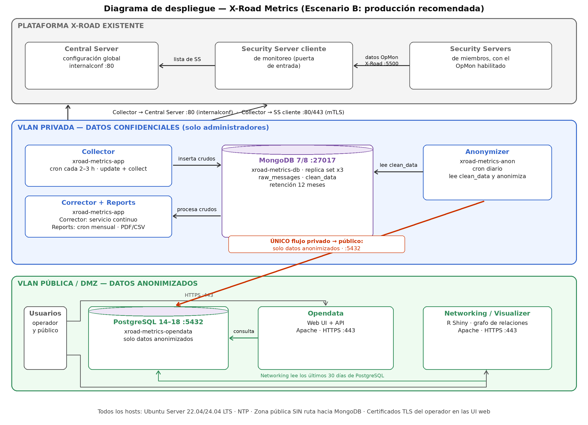
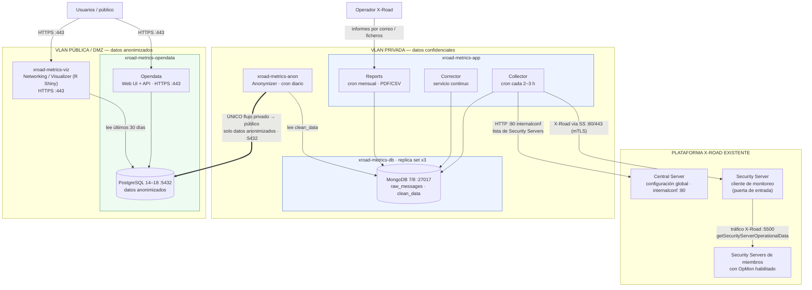

# Diagrama de despliegue — X-Road Metrics (Escenario B, producción recomendada)

Fuente editable en Mermaid (se renderiza directamente en GitHub):

## Notas de implementación
- Todos los hosts: Ubuntu Server 22.04/24.04 LTS, NTP activo, nombres según `04-diseno-despliegue.md`.
- MongoDB en replica set de 3 nodos en producción (en el dibujo se agrupa como un solo bloque lógico).
- El Anonymizer es el **único** componente con conectividad entre zonas, y solo hacia PostgreSQL:5432.
- Para el piloto (Escenario A) todo el bloque privado cabe en un host y el público en otro — o se omite hasta la fase 2.
